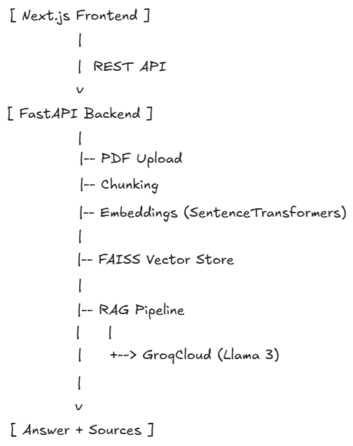

# AI Knowledge Assistant (RAG System)

A full-stack AI application that allows users to upload documents and ask questions grounded strictly in the uploaded content.

## Features
- Document upload and ingestion (PDF)
- Semantic chunking and local embeddings
- FAISS-based vector similarity search
- Retrieval-Augmented Generation (RAG)
- Source-grounded answers with citations
- Fast, hosted LLM inference via GroqCloud (Llama 3)
- Next.js frontend for interactive querying

## Tech Stack
**Frontend**
- Next.js (App Router)
- TypeScript
- Tailwind CSS

**Backend**
- FastAPI
- SentenceTransformers
- FAISS
- GroqCloud (Llama 3)
- Pydantic Settings

## Architecture


## How It Works
1. User uploads a document
2. Backend chunks and embeds the document
3. Embeddings stored in FAISS vector index
4. User question is embedded and matched to relevant chunks
5. Retrieved context is passed to an LLM with strict grounding
6. Answer is returned with source citations

## Running Locally

### Backend
```bash
cd backend
pip install -r requirements.txt
uvicorn app.main:app --reload

```

### frontend

```bash
cd frontend
npm install
npm run dev