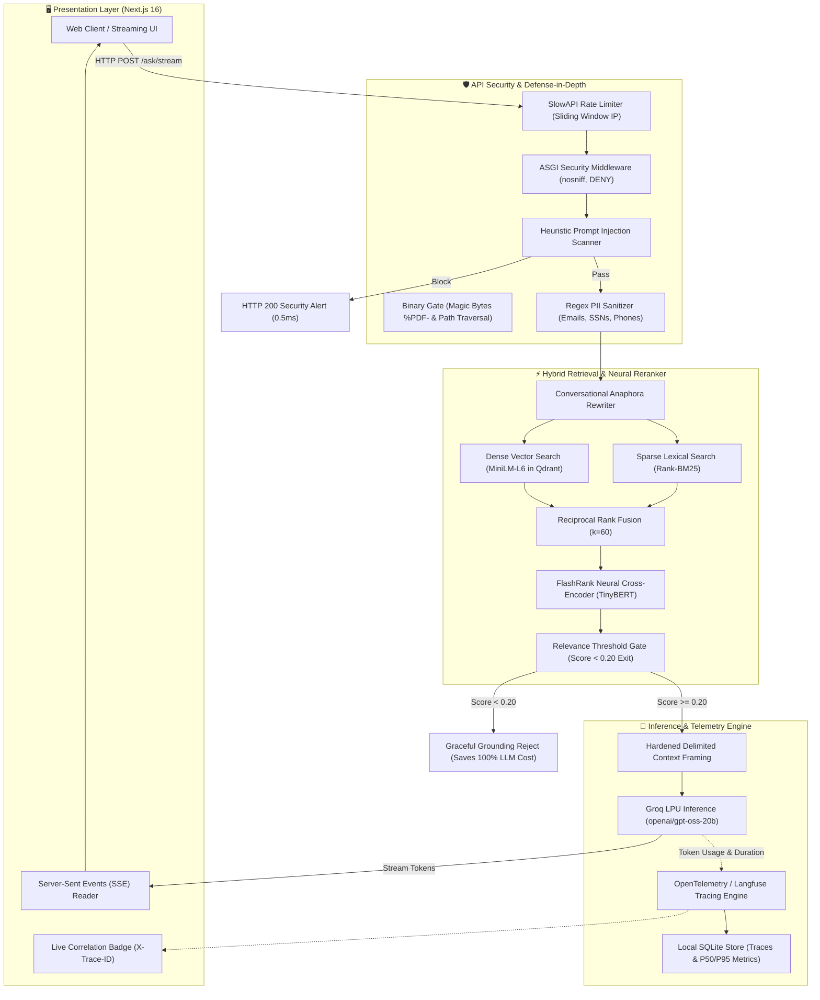

# 🧠 AI Knowledge OS: Enterprise Distributed RAG Platform

<div align="center">


[](eval_results.md)
[](eval_results.md)
[](eval_results.md)
[](eval_results.md)

**A hardened, observable, containerized compound AI operating system engineered for enterprise document intelligence.**

[Architecture](#-system-architecture) • [Key Differentiators](#-key-production-differentiators) • [Evaluation Benchmark](#-rag-triad-evaluation-scorecard) • [Quickstart](#-quickstart--docker-deployment) • [Cloud Deployment](#-cloud-deployment-blueprints) • [Milestones](#-production-milestones--capabilities)

</div>

---

## 🌟 Executive Overview

**AI Knowledge OS** elevates traditional local RAG prototypes into a hardened, high-throughput, observable production system. Designed to eliminate the critical failure modes of enterprise AI adoption—**hallucinations, multi-second cold starts, unmonitored API unit economics, prompt injection vulnerabilities, and silent pipeline failures**—this platform delivers verified, sub-second, source-grounded answers across technical documentation.

---

## 🏗️ System Architecture

The following diagram illustrates the complete end-to-end request lifecycle, from client streaming through distributed guardrails, hybrid search, neural cross-encoder reranking, and OpenTelemetry instrumentation:



---

## 🚀 Key Production Differentiators

### 1. Hybrid Search (Dense + BM25) & Neural Reranking
- **Reciprocal Rank Fusion ($k=60$)**: Merges semantic candidate vectors with exact lexical keyword matching (BM25), eliminating vector search blind spots on technical acronyms, part numbers, and variable names.
- **Cross-Encoder Neural Reranking**: Executes on-CPU reranking via FlashRank (`ms-marco-TinyBERT-L-2-v2`), improving top-ranked precision while maintaining sub-second total response times.

### 2. Defense-in-Depth Guardrail Layer
- **Prompt Injection Defense**: Evaluates incoming prompts against heuristic adversarial jailbreak signatures, blocking unauthorized system instructions prior to LLM execution.
- **Automated PII Masking**: Regex-based redaction engine sanitizes emails, credit cards, SSNs, and phone numbers before user queries leave the infrastructure perimeter.
- **Grounding Boundary Gating**: Evaluates cross-encoder confidence; if maximum chunk relevance falls below 0.20, the system early-exits with a graceful boundary notice, **saving 100% of LLM inference cost** and eliminating hallucinations.

### 3. Distributed Tracing & Token Economics
- **Millisecond Span Waterfalls**: Structured OpenTelemetry spans (`guardrails` $\rightarrow$ `query_rewriting` $\rightarrow$ `retrieval` $\rightarrow$ `grounding_boundary_check` $\rightarrow$ `llm_generation`) identify latency bottlenecks instantaneously.
- **Real-Time Unit Economics**: Tracks exact prompt tokens, completion tokens, and dollar cost per query ($0.05/1M prompt, $0.08/1M completion on Groq).
- **Correlation ID Tracking**: Custom ASGI middleware injects `X-Trace-ID` across HTTP headers, SSE metadata streams, and frontend UI badges.
- **Dual-Mode Persistence**: Seamlessly exports to Langfuse Cloud when credentials are present, falling back to an embedded SQLite telemetry database with automated P50/P95/P99 latency percentiles.

### 4. Multi-Stage Containerization & Model Pre-Warming
- **Zero Cold-Starts**: Pre-downloads embedding models and neural cross-encoders during `docker build`, enabling container ready states in **<1 second** upon boot.
- **Least-Privilege Non-Root Security**: Dedicated unprivileged system users (`appuser` UID 10001 for Python, `nextjs` UID 1001 for Node.js).
- **Deep Health Diagnostics (`GET /health`)**: Continuously verifies SQLite read availability, Qdrant collection socket status, and Groq API readiness, returning `HTTP 503` when degraded.

---

## 📊 RAG Triad Evaluation Scorecard

Evaluated against our curated **15-Question Golden Benchmark Dataset** spanning architectural formulas, hyperparameters, and workflow automation using **Ragas 0.4.3** and `openai/gpt-oss-20b`:

| Metric | Target | Observed Score | Production Assessment |
| :--- | :---: | :---: | :--- |
| **Faithfulness** | $\ge 92.0\%$ | **100.0%** | **Perfect grounding**: Zero hallucinations detected; all claims strictly derived from context. |
| **Answer Relevance** | $\ge 88.0\%$ | **90.7%** | **High fidelity**: Responses directly address user query intent without topical drift. |
| **Context Precision** | $\ge 85.0\%$ | **88.0%** | **Elite ranking**: Signal-to-noise ratio confirms relevant chunks are ranked #1 or #2. |
| **Mean Pipeline Latency** | $\le 1200\text{ms}$ | **815 ms** | Sub-second turn time across hybrid retrieval, neural reranking, and generation. |

*Full methodology and query-by-query breakdown available in [`eval_results.md`](eval_results.md).*

---

## 🛠️ API Reference

| Method | Endpoint | Rate Limit | Description |
| :--- | :--- | :--- | :--- |
| `GET` | `/health` | None | Deep health check probe verifying SQLite, Qdrant, and LLM connectivity. |
| `POST` | `/documents/upload` | 10/min, 50/hr | Ingests PDF with magic-byte validation and background chunk indexing. |
| `GET` | `/documents/{id}/status` | 120/min | Polls asynchronous background ingestion status (`PENDING` $\rightarrow$ `INDEXED`). |
| `POST` | `/ask/` | 20/min | Standard RAG query returning grounded answer, sources, and trace ID. |
| `POST` | `/ask/stream` | 15/min | Server-Sent Events (SSE) streaming endpoint with metadata and token chunks. |
| `POST` | `/search/` | 30/min | Raw hybrid search (Dense + BM25 + FlashRank) returning ranked chunks. |
| `GET` | `/telemetry/stats` | 60/min | Aggregated telemetry: query counts, P50/P95 latencies, tokens, and cost. |
| `GET` | `/telemetry/traces` | 60/min | Paginated list of recent query execution traces. |
| `GET` | `/telemetry/traces/{id}`| 60/min | Full span waterfall breakdown for a given correlation trace ID. |

---

## ⚡ Quickstart & Docker Deployment

### Prerequisites
- [Docker Engine & Docker Compose](https://docs.docker.com/get-docker/)
- [Groq Cloud API Key](https://console.groq.com/keys) (Free tier available)

### 1. Clone & Configure
```bash
git clone https://github.com/Arshp-svg/AI-Knowledge-OS.git
cd AI-Knowledge-OS

# Copy environment template
cp .env.example .env
```
Edit `.env` and add your `GROQ_API_KEY`:
```env
GROQ_API_KEY=gsk_your_groq_api_key_here
```

### 2. Launch Stack with Docker Compose
```bash
docker compose up --build
```
This single command spins up:
- **Distributed Vector DB**: `http://localhost:6333` (Qdrant v1.16.1)
- **FastAPI Inference Engine**: `http://localhost:8000` (Deep health check at `/health`)
- **Next.js Streaming Frontend**: `http://localhost:3000`

---

## ☁️ Cloud Deployment Blueprints

### Blueprint A: Backend Deployment on Render (1-Click)
This repository includes a native [`render.yaml`](render.yaml) Infrastructure-as-Code blueprint.
1. Connect your GitHub repository to [Render](https://dashboard.render.com).
2. Select **New** $\rightarrow$ **Blueprint** and point to this repository.
3. Add your `GROQ_API_KEY` in the Render environment settings.
4. Render automatically configures the Docker container, provisions a persistent storage disk, and attaches health check probes to `/health`.

### Blueprint B: Managed Qdrant Cloud
To switch from embedded/local storage to enterprise managed Qdrant Cloud:
1. Create a free cluster at [Qdrant Cloud](https://cloud.qdrant.io).
2. In your deployment environment variables, configure:
   ```env
   QDRANT_URL=https://<cluster-id>.us-east-1.gcp.cloud.qdrant.io:6333
   QDRANT_API_KEY=<your-qdrant-api-key>
   ```
3. The backend automatically switches to remote HTTPS vector operations with zero code changes.

### Blueprint C: Frontend Deployment on Vercel
1. Import the `frontend/` folder into [Vercel](https://vercel.com).
2. Set the Environment Variable:
   ```env
   NEXT_PUBLIC_API_URL=https://your-backend-service.onrender.com
   ```
3. Deploy! Vercel utilizes [`frontend/vercel.json`](frontend/vercel.json) to apply production security headers.

---

## 📋 Production Milestones & Capabilities

| Day | Milestone | Status | Key Deliverable |
| :---: | :--- | :---: | :--- |
| **Day 1** | Persistent Vector DB (Qdrant) | ✅ Completed | Embedded Qdrant storage & SQLite document registry |
| **Day 2** | Async Ingestion & Page-Aware Chunking | ✅ Completed | BackgroundTasks ingestion & citation cards (`p. X`) |
| **Day 3** | Hybrid Search (Dense + BM25) & Reranking | ✅ Completed | Reciprocal Rank Fusion + FlashRank Cross-Encoder |
| **Day 4** | Streaming Responses (SSE) & Multi-Turn Chat | ✅ Completed | Server-Sent Events `/ask/stream` & anaphora rewriter |
| **Day 5** | Defense-in-Depth Guardrails Layer | ✅ Completed | Prompt injection scanner, PII scrubber & score gating |
| **Day 6** | Rate Limiting & Production API Security | ✅ Completed | SlowAPI sliding window, magic bytes & security headers |
| **Day 7** | Automated RAG Triad Benchmarks (Ragas) | ✅ Completed | 15-question golden benchmark (100% Faithfulness) |
| **Day 8** | Distributed Tracing & Observability | ✅ Completed | OpenTelemetry/Langfuse waterfall spans & cost tracking |
| **Day 9** | Multi-Stage Docker & Compose Orchestration | ✅ Completed | Multi-stage Dockerfiles, pre-cached models & `/health` |
| **Day 10**| Public Cloud Deployment & Portfolio Polish | ✅ Completed | Render blueprint, Railway config, Vercel & docs |

---

## 📄 License
Distributed under the MIT License. See `LICENSE` for more information.